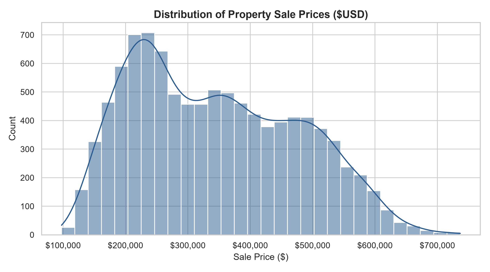
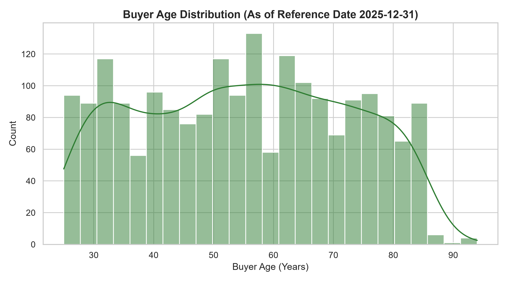
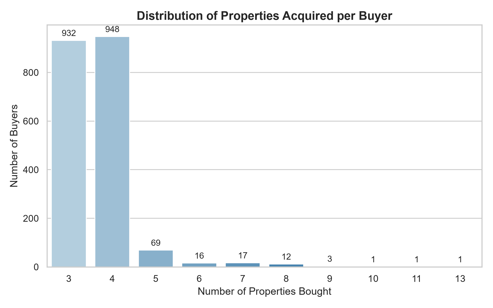
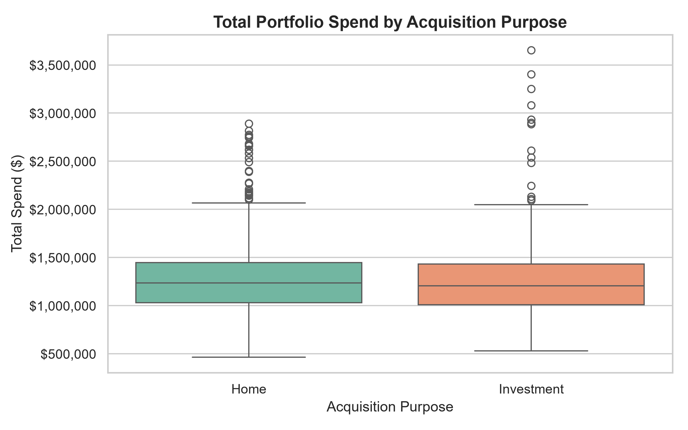
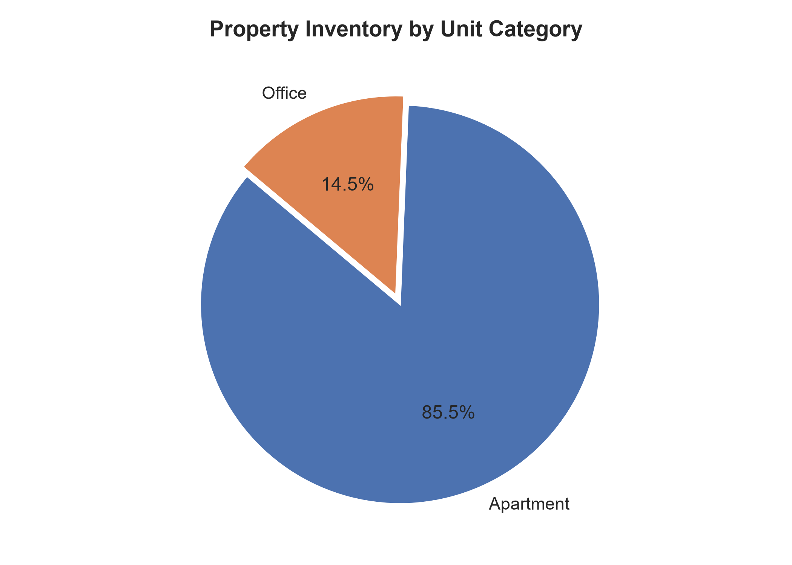
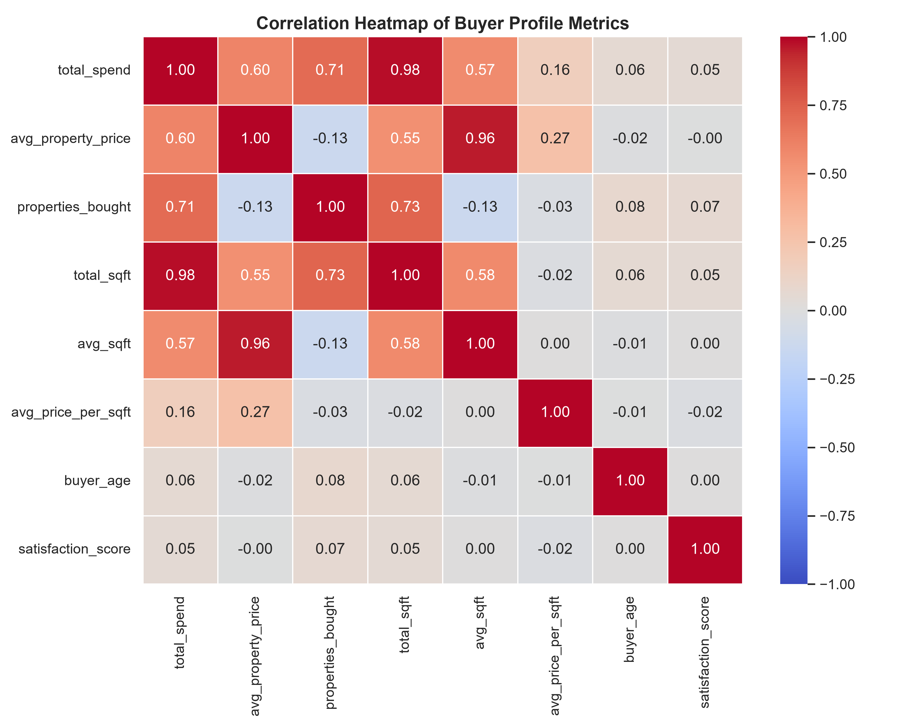
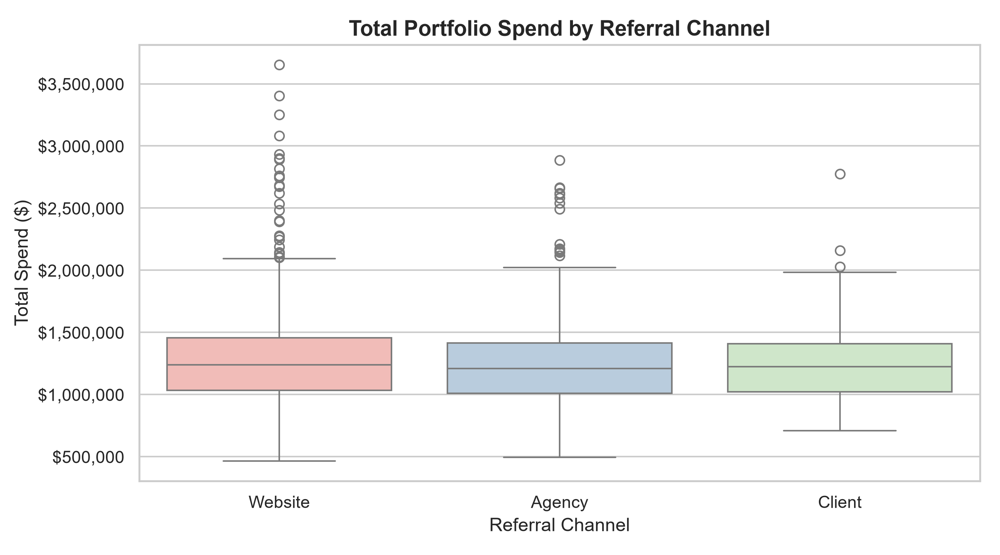

# Exploratory Data Analysis (EDA) Report

**Project Title:** Machine Learning Based Buyer Segmentation and Investment Profiling for Real Estate Market Intelligence  
**Dataset Scope:** 2,000 Clients & 10,000 Property Listings  

---

## 1. Overview of Key Statistical Findings

### Property Pricing & Characteristics
- **Average Property Sale Price:** $344,374.68 (Median: $330,680.84)
- **Property Price Range:** $97,402.80 to $736,652.27
- **Average Floor Area:** 1139.94 sqft (Range: 410.71 to 1957.16 sqft)
- **Average Price / Sqft:** $302.14 (Apartments: $300.11, Offices: $314.07)

### Buyer Portfolio Characteristics
- **Average Portfolio Spend per Buyer:** $1,260,375.48
- **Portfolio Spend Range:** $463,611.95 to $3,653,385.38
- **Properties Acquired per Buyer:** 3 to 13 properties (Average: 3.65 properties)
- **Buyer Age Distribution:** Mean age is 55.1 years (Range: 25 to 94 years)

---

## 2. Visual Exploratory Insights

### A. Property Sale Price Distribution

*Figure 1: Distribution of sale prices across all properties in the dataset. Prices exhibit a slightly right-skewed distribution centered around ~$330,000.*

---

### B. Buyer Age Profile

*Figure 2: Age distribution of registered buyers calculated as of 2025-12-31. Buyers range from young adults (25) to senior investors (94).*

---

### C. Buyer Portfolio Scale

*Figure 3: Distribution of property acquisition counts. The majority of active buyers hold 3 to 4 properties, while a high-net-worth minority holds up to 13 properties.*

---

### D. Total Spend by Acquisition Purpose

*Figure 4: Portfolio investment comparison between buyers acquiring for personal Home use versus Investment purpose.*

---

### E. Inventory Composition by Unit Category

*Figure 5: Proportion of property listings by unit category (85.5% Apartment vs 14.5% Office).*

---

### F. Buyer Metric Feature Correlations

*Figure 6: Heatmap depicting pair-wise linear correlations among buyer portfolio metrics. Total spend shows strong positive correlation with properties bought and total floor area.*

---

### G. Total Spend across Referral Channels

*Figure 7: Total portfolio spending distribution across client acquisition channels (Website, Agency, and Client Referral).*

---
